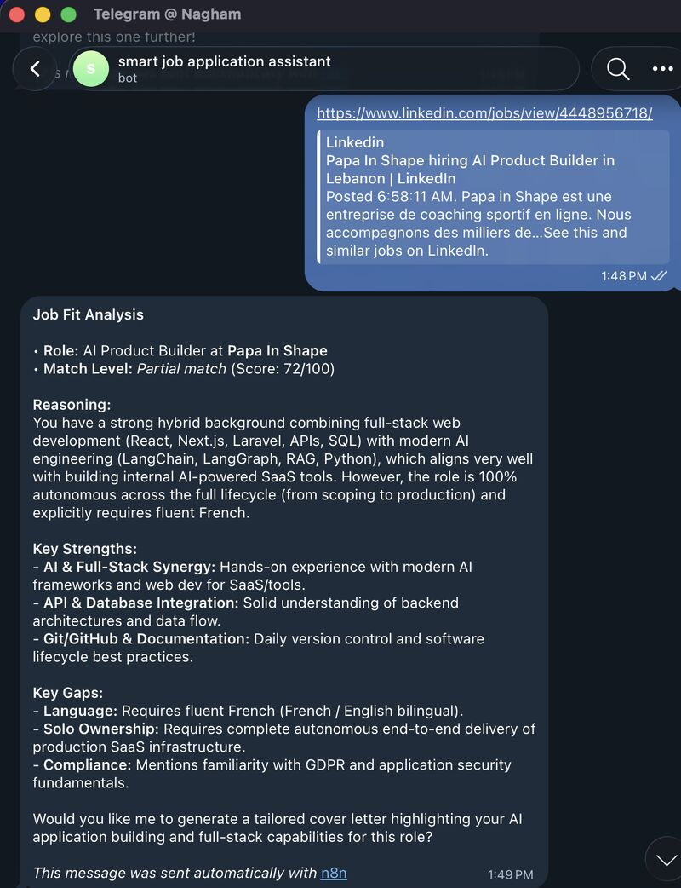
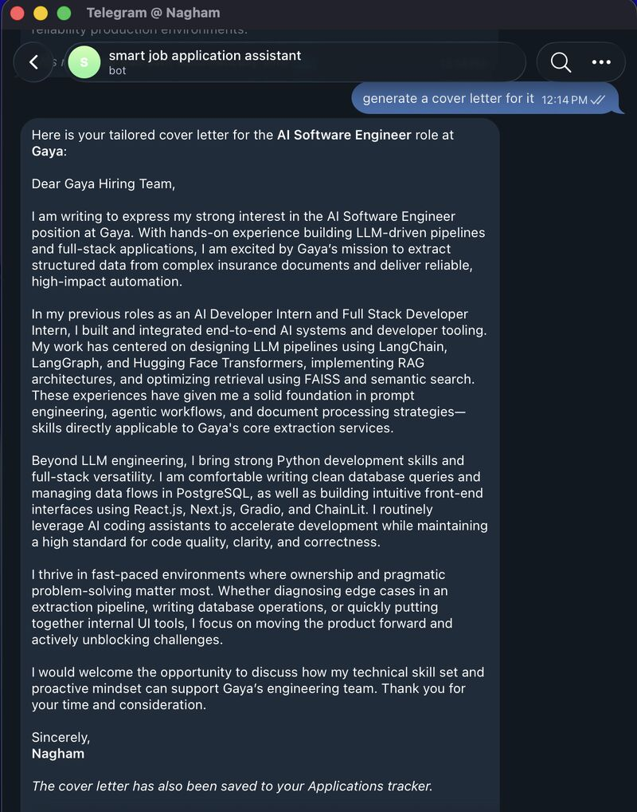
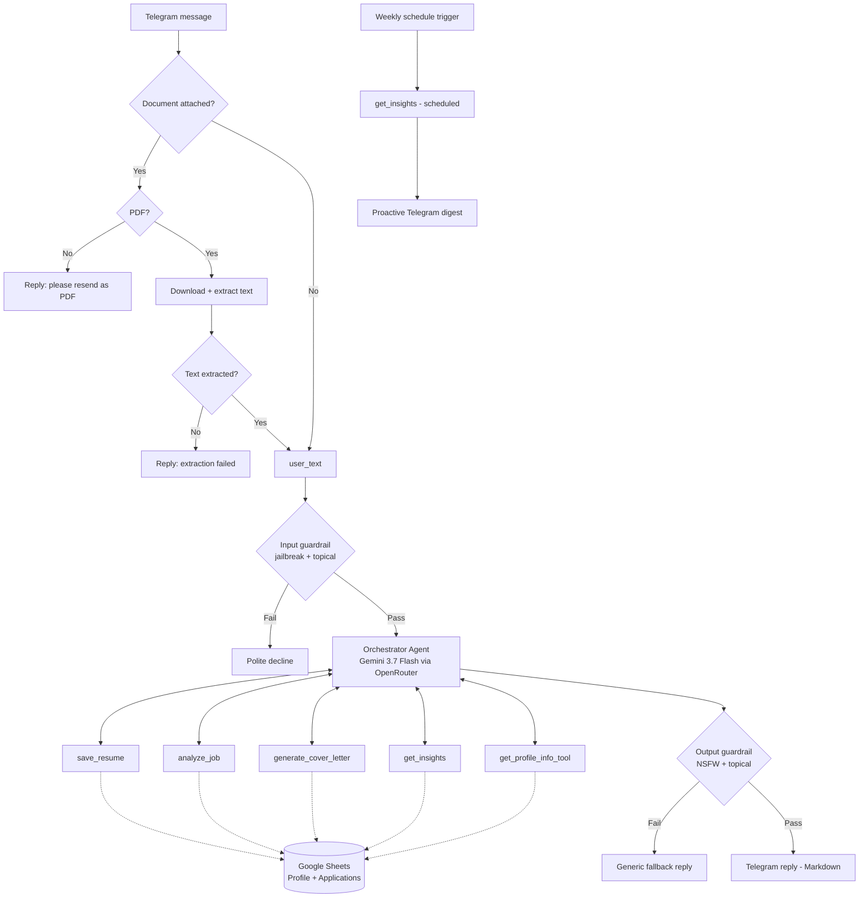
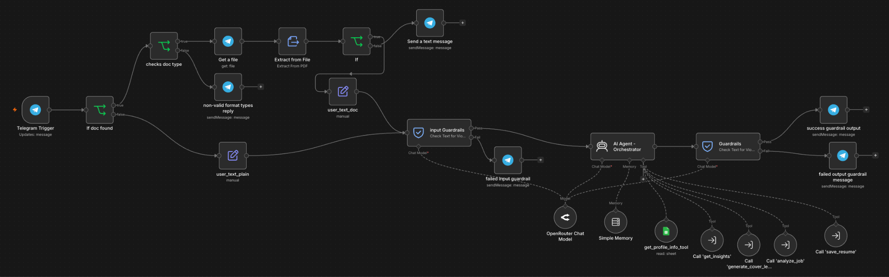
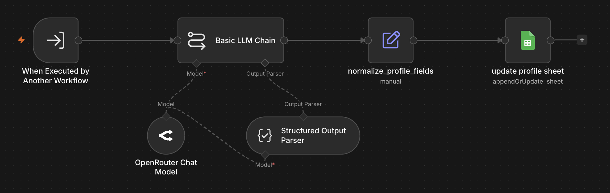
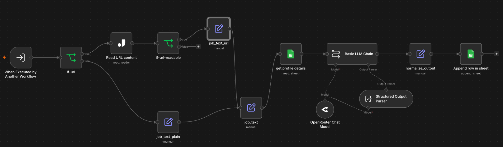
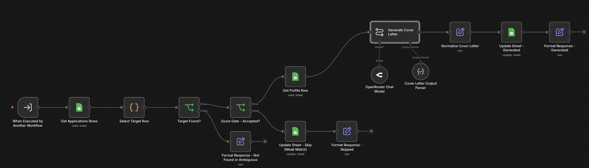
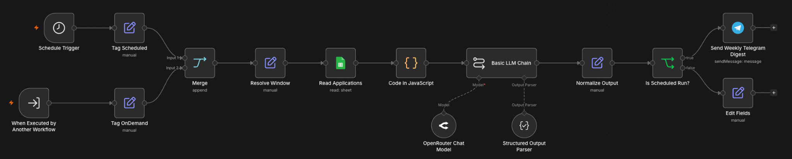

# AI Job Application Assistant

A Telegram-based AI agent, built in **n8n**, that helps a job seeker run their whole job search from one chat: save a resume once, get instant fit analysis against any job posting, generate tailored cover letters for strong matches, ask questions about their own background, and see patterns across applications over time — no spreadsheets to maintain by hand.

## Demo

<table>
  <tr>
    <td width="50%" valign="top"></td>
    <td width="50%" valign="top"></td>
  </tr>
  <tr>
    <td align="center">Job fit analysis from a job URL: score, match level, strengths, and gaps</td>
    <td align="center">Tailored cover letter for a previously analyzed job, saved to the tracker</td>
  </tr>
</table>

---

## Features

- **Resume storage** — upload a PDF resume once; it's parsed into structured fields and reused everywhere.
- **Job fit analysis** — paste a job description or a URL and get a 0–100 match score, a Strong / Partial / Weak decision, specific gaps, and reasoning.
- **Gated cover letters** — tailored cover letters are generated only for Strong or Partial matches.
- **Profile Q&A** — ask general questions like "what roles fit me?" or "summarize my resume".
- **Application insights** — on-demand or weekly digests: application count, average score, decision breakdown, recurring gap themes, and suggested next actions.
- **Guardrails on both sides** — input checked for jailbreaks and off-topic requests; output checked for NSFW content and topic drift.

---

## Architecture

**The main workflow in n8n:**

### Entry points

| Trigger | Purpose |
|---|---|
| Telegram message | Main interactive path, routed through the Orchestrator |
| Weekly schedule | Runs `get_insights` directly (tagged `scheduled`) and pushes a digest to Telegram |

### Request flow

1. **Pre-processing** — PDFs are MIME-validated, downloaded, and text-extracted; plain text passes straight through. Both paths converge into a single `user_text` field.
2. **Input guardrail** — jailbreak detection and topical alignment (threshold 0.7). Failing messages never reach the Orchestrator.
3. **Orchestrator** — a single AI Agent node with conversation memory that decides whether to answer directly or call one of five tools, and what to do with the result.
4. **Output guardrail** — NSFW and topical-alignment checks on the reply.
5. **Delivery** — Markdown-formatted reply via Telegram.

---

## Tools

| Tool | Type | What it does |
|---|---|---|
| `save_resume` | Sub-workflow | Extracts name, skills, years of experience, education, and past roles using a Basic LLM Chain + Structured Output Parser; append-or-update to the **Profile** sheet on `profile_id`. |
| `analyze_job` | Sub-workflow | Takes pasted text or a URL (scraped via Jina AI Reader), scores it against the saved profile, and appends score, decision, gaps, and reasoning to the **Applications** sheet. Rejects login-walled pages before they reach the LLM. |
| `generate_cover_letter` | Sub-workflow | Finds a previously analyzed job (by title/company, or the most recent), enforces the Strong/Partial match gate, writes a tailored letter, and saves it back to the sheet. Asks for clarification when multiple jobs match. |
| `get_insights` | Sub-workflow | Computes stats deterministically in a Code node, then uses an LLM chain only for the summary, gap-theme clustering, and next actions. Runs on demand or weekly. |
| `get_profile_info_tool` | Google Sheets tool | Reads the Profile row directly to answer general background/career questions. No sub-workflow needed. |

### Sub-workflows

<code>save_resume</code>

<code>analyze_job</code>

<code>generate_cover_letter</code>

<code>get_insights</code>

---

## Tech stack

- **Orchestration:** n8n (AI Agent, Basic LLM Chain, Structured Output Parser, Guardrails, Execute Workflow, Code nodes)
- **LLM:** `google/gemini-3.7-flash` via OpenRouter (used for every LLM node)
- **Interface:** Telegram Bot API
- **Storage:** Google Sheets
- **Web scraping:** Jina AI Reader

---

## Setup

### Prerequisites

- An n8n instance (self-hosted or cloud) with the Guardrails node available
- A Telegram bot token (from [@BotFather](https://t.me/BotFather))
- An OpenRouter API key
- A Google account with Sheets access (OAuth credential in n8n)

### 1. Create the Google Sheet

Create a spreadsheet with two tabs:

- **Profile** — one row per candidate, keyed on `profile_id` (name, skills, years of experience, education, past roles)
- **Applications** — one row per analyzed job (job title, company, match score, decision, gaps, reasoning, cover letter)

> Make sure header names match the field names used in the workflows exactly — trailing whitespace in headers will break lookups.

### 2. Import the workflows

Import the main Orchestrator workflow and the four sub-workflows (`save_resume`, `analyze_job`, `generate_cover_letter`, `get_insights`) into n8n. Then update the **Execute Workflow** nodes in the Orchestrator to point at the imported sub-workflow IDs.

### 3. Configure credentials

In n8n, create and attach:

| Credential | Used by |
|---|---|
| Telegram API | Trigger, reply, and digest nodes |
| OpenRouter | Orchestrator, all LLM chains, Guardrails nodes |
| Google Sheets OAuth2 | All Sheets read/write nodes |

Point every Google Sheets node at your new spreadsheet and tabs.

### 4. Activate

Activate the main workflow (Telegram trigger) and the weekly schedule trigger. Send your bot a PDF resume to get started.

---

## Usage

| You send | What happens |
|---|---|
| A PDF resume | Parsed and saved to your profile |
| A job description or job URL | Fit score, decision, gaps, and reasoning |
| "Write a cover letter for the Acme role" | Tailored letter, if the match was Strong or Partial |
| "What roles fit my background?" | Answer drawn from your saved profile |
| "How's my job search going?" | Insights summary with recurring gaps and next steps |

Every week, you'll also get an automatic insights digest.

---

## Design decisions

- **One Orchestrator, five tools — not one agent per task.** Agency comes from deciding whether and which tool to call and what to do with the result. A fixed chain of agents would just be a script.
- **Only the Orchestrator is an Agent node.** Extraction, scoring, generation, and summarization are single-shot structured transformations with no decisions to make, so they use Basic LLM Chains with Structured Output Parsers.
- **Google Sheets over a vector store.** The data is relational and structured; matching is LLM-reasoned against structured profile fields, not similarity search.
- **No RAG.** Like real ATS pipelines, matching compares the resume against the job's stated requirements. Outside retrieval would add complexity without improving the core task.
- **One model, one provider.** Gemini 3.7 Flash via OpenRouter keeps a single credential and gives reliable structured output with low latency for real-time chat.
- **Deterministic guardrails where possible.** File validation, extraction checks, URL readability, and the match-score gate are enforced by IF nodes, validation logic, or Guardrails nodes — not by asking the LLM to police itself.
- **Explicit, permissive tool-trigger prompts.** The Orchestrator's system prompt spells out when each tool should be used, after terse tool descriptions were observed to make the model skip tool calls.

---

## Evaluation

Tested with live n8n executions against expected outcomes, using a real resume, hand-picked job postings across strong/partial/weak fit (as text and URLs, including a login-walled one), adversarial and off-topic messages, and ambiguous multi-intent prompts.

1. **Per-tool functional tests** — a normal input, an edge case, and a failure case per tool.
2. **Orchestrator tool-selection tests** — ambiguous or layered intents, follow-ups referencing jobs by partial name, and casual messages that should trigger no tool.
3. **Guardrail tests** — jailbreak and off-topic inputs blocked before the Orchestrator; borderline outputs to sanity-check output thresholds.

A test passes if the correct tool (or none) is invoked, the output matches the expected structure and business logic, and guardrails behave at their configured thresholds. Results were logged from n8n's execution history and failures traced to root cause.

---

## Limitations

- **Single user.** One Profile row on a fixed `profile_id`. Multi-user support would require keying both sheets by Telegram chat ID.
- **Limited job sources.** Pages that require sign-in to view the job description are rejected; users must paste the description instead.

## Roadmap

- **Scalable persistence** — move to Supabase/Postgres for server-side filtering and aggregation.
- **Proactive job discovery** — scrape job platforms automatically and recommend strong matches, turning the assistant from reactive to proactive.
